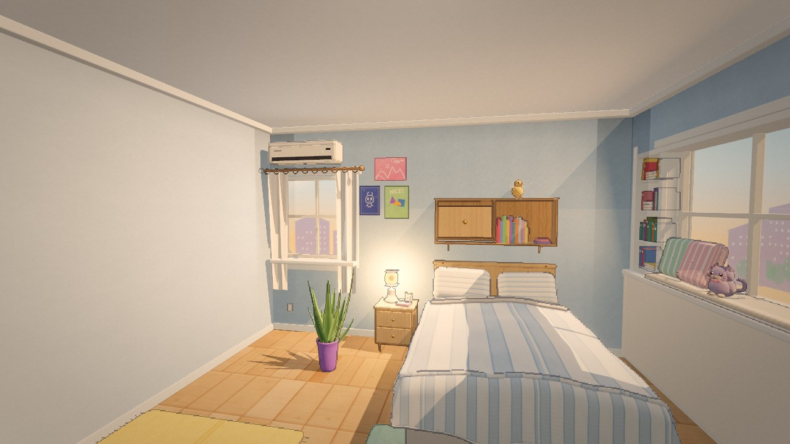
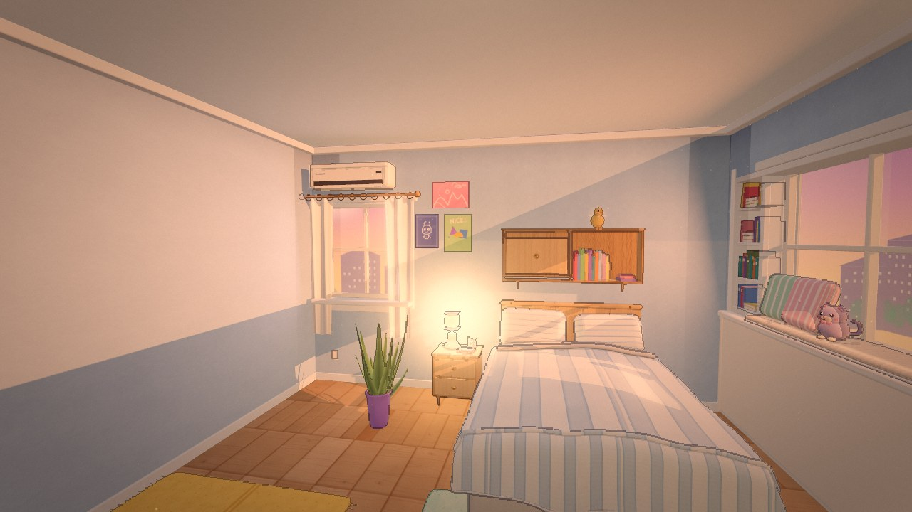
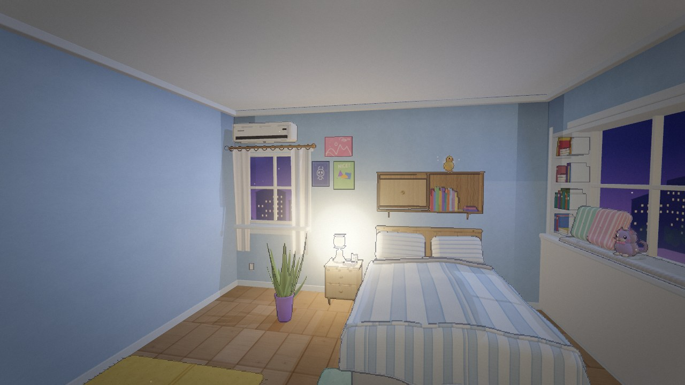
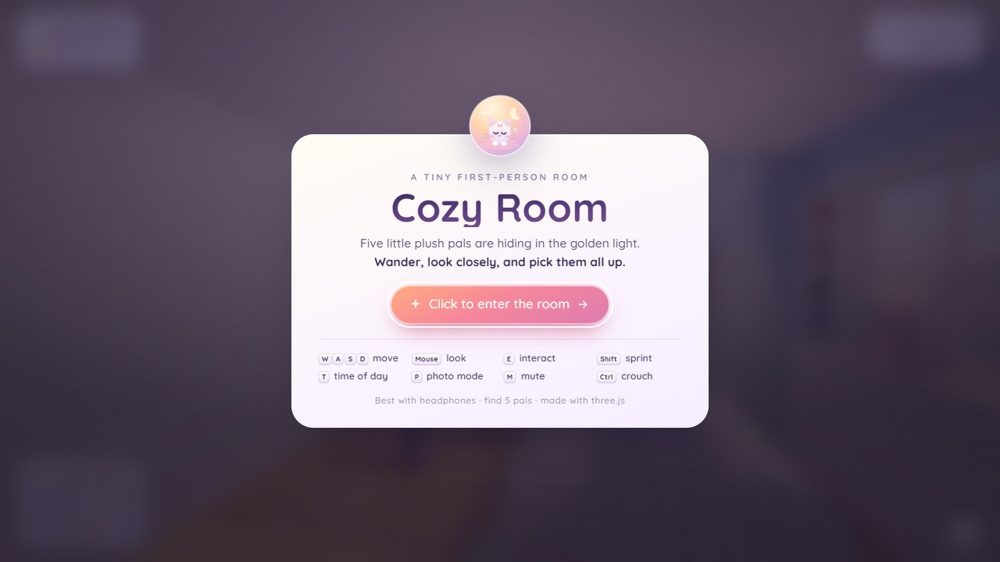

# Cozy Room — a tiny first-person room

A single-room, first-person 3D game built in JavaScript with **three.js**. The room is a
faithful real-time reconstruction of an isometric bedroom reference, rendered in a **cute,
pastel, clean-edged anime-real style**. Every texture, poster, book, plush and fixture is
generated procedurally at boot — there are **no external image, model or audio assets**.

[**▶ Play the live demo**](https://kiuckhuang.github.io/cozy-room/) · [Source code](https://github.com/kiuckhuang/cozy-room)



| Golden hour | Lavender dusk |
|---|---|
|  |  |
| **Quiet night** | **Intro screen** |
|  |  |

---

## Play

### Live (GitHub Pages)
Open **[https://kiuckhuang.github.io/cozy-room/](https://kiuckhuang.github.io/cozy-room/)**.

### Local server (development)
```bash
npm install
node tools/serve.mjs          # http://127.0.0.1:4173
```
Open **http://127.0.0.1:4173/** and click **“Click to enter the room”**.

### Portable build (no server)
Open **`docs/index.html`** directly in Chrome / Edge / Firefox. It is a self-contained IIFE
bundle (three.js + game + styles + vendored font) and runs from `file://`.

```bash
npm install
npm run build                 # rebuild docs/ (the GitHub Pages build)
```

### Hardware acceleration (GPU)
The game renders with WebGL2 and runs on the GPU in any normal desktop browser. Inside a
**WSL2 Linux** browser it does not — that is an environment limit, not a game bug. Measured on
this machine (RTX 5090, Windows 11 + WSL2):

| Browser runs on | WebGL renderer | 1280x720 |
|---|---|---|
| Windows (Chrome, D3D11) | `ANGLE (NVIDIA GeForce RTX 5090 Direct3D11)` | **60 fps** (vsync), ~116 fps uncapped at 1080p |
| WSL2 Linux (Chrome) | SwiftShader / llvmpipe (CPU) | ~1.4 fps |

WSL2 *does* expose the GPU — `/dev/dxg` exists, `nvidia-smi` reports the card and CUDA works —
but it presents it as **D3D12**, and Mesa's `d3d12`/`dzn` drivers are not packaged in this
distro, so Linux Chrome has no hardware GL/Vulkan path and silently falls back to SwiftShader.
That is why the headless QA browser was slow; nothing in the game needs changing.

- **Play with the GPU:** open the Pages link above, or `http://localhost:4173` in a Windows
  browser while `node tools/serve.mjs` runs in WSL (mirrored networking makes it reachable).
- **QA/perf/screenshots with the GPU:** `node tools/host-gpu.mjs start` launches headless Chrome
  on the Windows host and prints a CDP endpoint; export it and every tool renders on the GPU:
  ```bash
  export CDP_URL=$(node tools/host-gpu.mjs start --quiet)
  node tools/gpucheck.mjs                  # prints the unmasked renderer + frame pacing
  node tools/perf.mjs --w=1280 --h=720     # 60 fps, effective q=high (no software downgrade)
  node tools/media.mjs                     # README plates at q=high
  node tools/host-gpu.mjs stop
  ```
  Without `CDP_URL` the harness still runs headless in WSL with SwiftShader — fine for
  correctness (`npm test`), just slow.

### Controls
| Input | Action |
|---|---|
| **W A S D** | walk |
| **Mouse** | look (pointer lock) |
| **Shift** | sprint |
| **Ctrl** / **C** | crouch |
| **E** / **Left click** | interact / pick up |
| **T** | cycle time of day (Golden hour → Soft daylight → Lavender dusk → Quiet night) |
| **P** | photo mode (hides HUD) |
| **M** | mute |
| **Esc** | pause / release pointer |

### Objective
Five little plush pals are hiding around the room — **Twinkle** the star, **Mochi** the cloud
kitten, **Clover** the bunny, **Pip** the duckling and **Puff** the cloud. Find all five, listen
for their chime, and enjoy the room. You can also toggle the bedside lamp, desk lamp, ceiling
light, curtains and the air conditioner, and switch the light through four moods.

---

## What is in the room

Oak plank floor, pale-blue walls and white trim, a striped blue/white bed with a draped duvet
and pinstripe pillows, boarded headboard with a shallow oak shelf (drawer + books), a two-drawer
nightstand with a butter-yellow lamp, a snake plant in a purple glazed pot, a yellow woven rug
and mint mat, a north window with sheer curtains and an AC unit, three posters (pink landscape,
indigo pixel creature, green “NICE!”), the east bay window with a recessed bookshelf, padded
window seat and striped cushions, a calendar and brass hexagons, a lilac metal desk with a
three-drawer pedestal and cute clutter, a ladder-back chair, a pedal bin, a door with a charm,
a ceiling light, and five plush pals.

**Time-of-day moods**
- **Golden hour** (default) — warm late light through the bay window, glowing bedside lamp, dust.
- **Soft daylight** — bright neutral morning.
- **Lavender dusk** — violet walls, peach sun, both practical lamps on.
- **Quiet night** — periwinkle moonlight, city lights, warm lamps.

---

## Technical notes

- **Renderer**: WebGL2, ACES filmic tone mapping, sRGB output, PCFSoft sun shadows (4096²),
  MSAA composer targets, bloom, a custom depth/normal **illustration-outline + pastel grade +
  grain + vignette** pass, dust motes, and a procedural PMREM environment.
- **Materials**: PBR cloth (sheen), wood, paper, ceramic, brushed metal, brass and glass with
  procedural canvas colour/normal/roughness maps (floor planks, wall paint, weave, stripes,
  rugs, sky, etc.).
- **Lighting**: warm sun through the bay window, cool north-window fill, rect area lights,
  practical lamps, per-mood lighting grade, AO strips at corners/ceiling and contact shadows.
- **No external assets**: only the OFL-licensed *Quicksand* font is vendored; everything else is
  painted or built at runtime.
- **Quality**: `?q=high|med|low` (default high; automatically Med on software WebGL).
  QA/screenshot helpers accept `?cam=x,y,z&look=x,y,z&hud=0&nostart=1`.

### Project layout
```
index.html                 import-map shell (dev server)
src/main.js                bootstrap, shared ctx contract, render loop
src/core/renderer.js       post pipeline + outline prepass
src/core/controls.js       first-person controls, collision, interaction raycast
src/core/audio.js          procedural WebAudio (room tone, birds, lo-fi pad, SFX)
src/world/textures.js      procedural textures & sky backdrops
src/world/materials.js     shared PBR material library
src/world/kit.js           geometry helpers (rounded boxes, books, shadows)
src/world/room.js          shell, windows, curtains, AC, door, ceiling, backdrops
src/world/lighting.js      sun/lamps/dust + four mood presets
src/world/furniture.js     bed, nightstand, shelf, desk, chair, bin, rugs
src/world/decor.js         posters, calendar, hexagons, books, plant, desk clutter
src/game/game.js           five plush pals, pickups, objectives
src/ui/                    HUD, intro, pause, completion, styles, font
tools/                     static server + Puppeteer QA harness (local or host-GPU over CDP)
tests/smoke.mjs            runtime smoke test (34 checks)
tests/nav.mjs              reachability/navigation test
docs/                      portable offline build served by GitHub Pages
media/                     screenshots used in this README
```

### Verification
- `node tests/smoke.mjs` — runtime errors, readiness, scene/renderer stats, interactables,
  collectibles, movement/collisions, photo mode, pause and `collectAll()` → completion.
- `node tests/nav.mjs` — spawn clear, walkable area, all five pals reachable.
- `node tools/shotset.mjs` — eight curated 960×540 screenshots + contact sheet.
- `node tools/gpucheck.mjs` — unmasked WebGL renderer, quality tier and frame pacing.
- `node tools/media.mjs` — regenerates the README plates (`media/`) at `?q=high&force=1`.
- `node tools/screenshot.mjs <url> <out.png> [waitMs]` — flexible single shot.
- Boots with empty `window.__ERRORS__` and no page/console errors.
- `node tests/smoke.mjs` passes **34/34** both on the WSL SwiftShader backend and on the host GPU
  through `CDP_URL` (measured 60 fps vsync-capped at 1280×720, `effective q=high`).

### Licences
Code is released under the **MIT License** (see `LICENSE`). Third-party notices — three.js
(MIT) and Quicksand (SIL OFL 1.1) — are listed in `THIRD_PARTY_NOTICES.md`; the font licence is
also included at `docs/fonts/OFL.txt`.

The reference photographs/illustrations used during development are **not** included in this
repository; only original screenshots of the generated game are included under `media/`.
